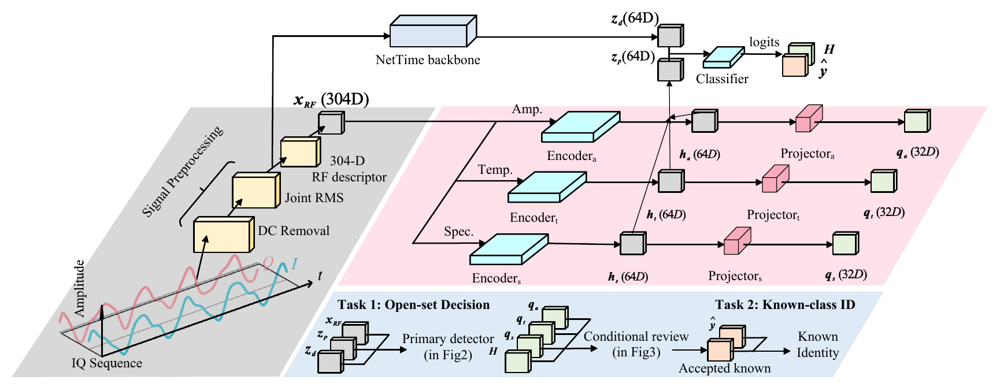
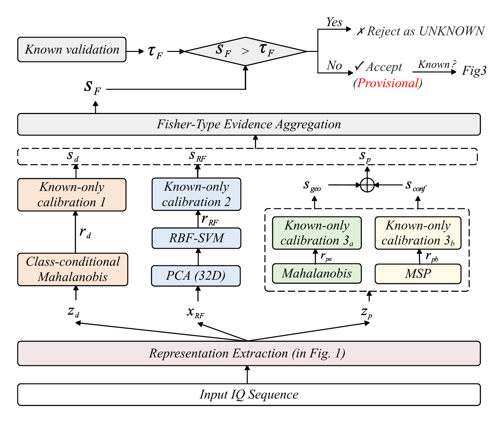
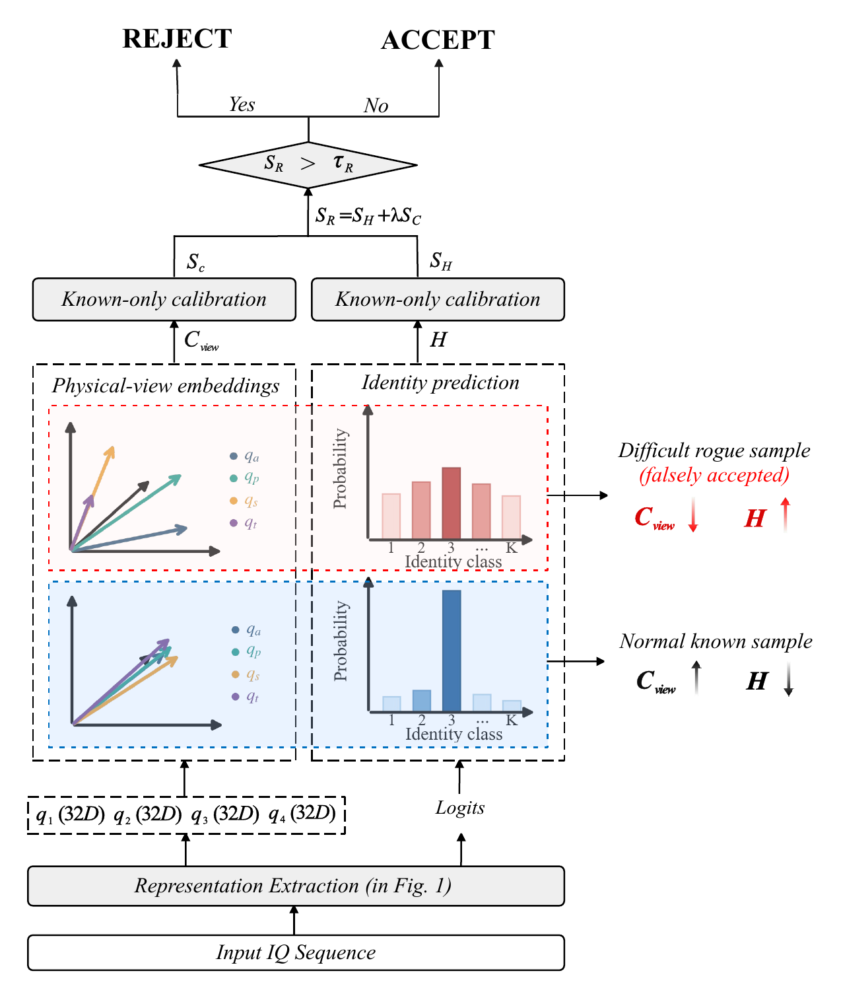

# CEACC-RFFI

Official research artifact for **“Open-Set RF Fingerprint Identification via
Complementary Evidence Aggregation and Cross-View Consistency.”**

**Paper status:** submitted manuscript. The archival article link and DOI will
be added after publication.

CEACC follows a **preserve–learn selectively–aggregate–re-examine** pipeline.
It preserves a complete explicit RF descriptor, learns complementary
amplitude/statistical, spectral, and temporal-envelope views, calibrates three
open-set evidence channels with known data only, and conditionally re-examines
provisionally accepted samples using cross-view geometry and classifier entropy.

## Method overview

### 1. Preserve and learn selectively

CEACC keeps the complete 304-D explicit RF descriptor instead of forcing all
RF cues into one learned representation. In parallel, a NetTime backbone
extracts a deep embedding, while dedicated encoders selectively learn
amplitude/statistical, spectral, and temporal-envelope views. These reusable
representations support both open-set screening and known-emitter
identification.

<p align="center">
  
</p>

### 2. Aggregate complementary known-only evidence

The primary detector operates in three complementary spaces: the deep
embedding, the explicit RF descriptor, and the learned multi-view embedding.
Each channel is calibrated using enrolled-device data only. Their empirical
tail evidence is then combined by a Fisher-type log-tail sum; in the learned
multi-view channel, geometric and classifier-confidence evidence are first
joined by a fixed OR rule. The resulting score either rejects the signal as
unknown or provisionally accepts it for the next stage.

<p align="center">
  
</p>

### 3. Re-examine provisional accepts

Only signals that pass the primary detector are re-examined. CEACC reuses the
physical-view projections to measure cross-view consistency and the classifier
logits to measure prediction entropy. Known-only empirical calibration turns
these cues into a conditional score, allowing difficult rogue signals hidden
inside the primary accepted region to be recovered without tuning on target
unknown samples.

<p align="center">
  
</p>

## Main results

| Dataset / setting | AUC | OSCR | Known accuracy | Unknown recall |
|---|---:|---:|---:|---:|
| ADS-B, primary three-space detector | 0.8499 | 0.7431 | 0.8593 | 0.5917 |
| ADS-B, complete CEACC | **0.8557** | **0.7505** | **0.8593** | **0.6854** |
| LoRa, transferred design | **0.9669** | **0.9645** | — | — |

The ADS-B numbers aggregate three registered known/rogue splits and three
random seeds. Model fitting, selection, score construction, and operating-point
calibration use enrolled-device data only; target unknown samples are exposed
only for final evaluation.

## Repository map

The numbered folders follow the experimental section of the paper:

1. [`experiments/01_external_baselines`](experiments/01_external_baselines) —
   NS-RFF, OpenMax, and HyperRSI protocol adaptations.
2. [`experiments/02_representation_preservation`](experiments/02_representation_preservation) —
   fixed-view and complementary-view architecture studies.
3. [`experiments/03_evidence_aggregation`](experiments/03_evidence_aggregation) —
   deep, explicit-RF, learned-view, and aggregation-rule comparisons.
4. [`experiments/04_conditional_reexamination`](experiments/04_conditional_reexamination) —
   accepted-region analysis and Fisher-retaining re-examination.
5. [`experiments/05_lora_transfer`](experiments/05_lora_transfer) —
   cross-protocol LoRa transfer without target-unknown tuning.
6. [`experiments/06_robustness`](experiments/06_robustness) —
   openness, leave-one-view, and temporal-shift tests.

Shared implementations live in [`src`](src); the compact CSV/JSON artifacts
used to report the paper tables live in [`results`](results). Raw RF recordings
and trained checkpoints are intentionally not committed; see
[`docs/DATA_AND_CHECKPOINTS.md`](docs/DATA_AND_CHECKPOINTS.md).

## Environment

```bash
python -m venv .venv
source .venv/bin/activate
pip install -r requirements.txt
export PYTHONPATH="$PWD/src:$PWD/baselines"
```

Python 3.10 and a CUDA-capable PyTorch installation were used for the reported
runs. The evaluation code also falls back to CPU, although full retraining is
substantially slower.

## Reproducing the paper panels

After placing the data and checkpoints under the paths documented in
[`docs/DATA_AND_CHECKPOINTS.md`](docs/DATA_AND_CHECKPOINTS.md), run the numbered
experiment launchers. For example:

```bash
bash experiments/03_evidence_aggregation/run.sh
bash experiments/04_conditional_reexamination/run.sh
```

The central evaluator regenerates the space-increment, aggregation-rule,
accepted-region, final outer-test, and openness tables from frozen checkpoints.
All scripts accept explicit paths or resolve the repository through
`PLSAR_ROOT`, so no machine-specific absolute paths are required.

## Baseline scope

The external methods are author-released components adapted to the same RF
input, registered splits, seeds, and known-only calibration protocol. They are
not claimed as original CEACC components. The result folders retain per-run
outputs and implementation notes so the distinction between native scores and
protocol adaptation is explicit.

## Citation

If you use this code or the reported results, please cite the accompanying
manuscript:

```bibtex
@unpublished{sun2026plsar,
  author = {Peng Sun and Ping Gan and Yaxin Luo and Yuanhong Zhong and Jianhong Cheng},
  title  = {Open-Set RF Fingerprint Identification via Complementary Evidence Aggregation and Cross-View Consistency},
  note   = {Submitted manuscript},
  year   = {2026},
  url    = {https://github.com/pengs5462-code/CEACC-RFFI}
}
```

Machine-readable metadata is provided in [`CITATION.cff`](CITATION.cff).
The citation will be updated with the journal, volume, pages, and DOI when the
archival article record becomes available.

## License

Original code in this repository is released under the [MIT License](LICENSE).
External datasets and referenced baseline repositories remain subject to their
respective licenses and terms.
